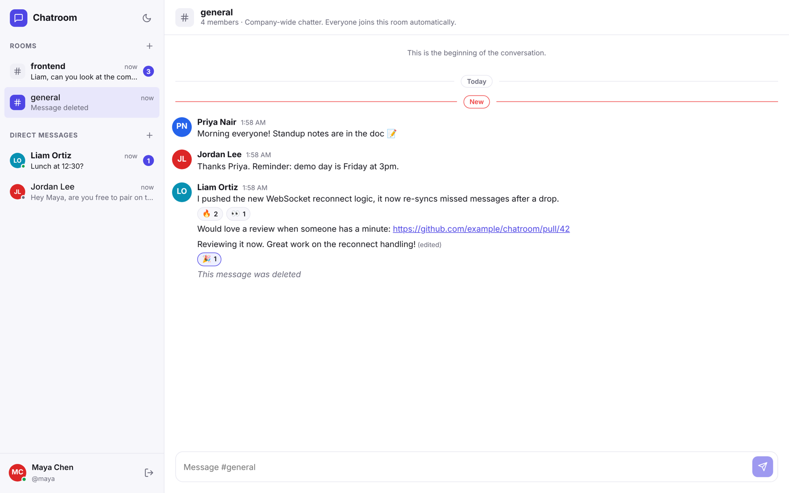
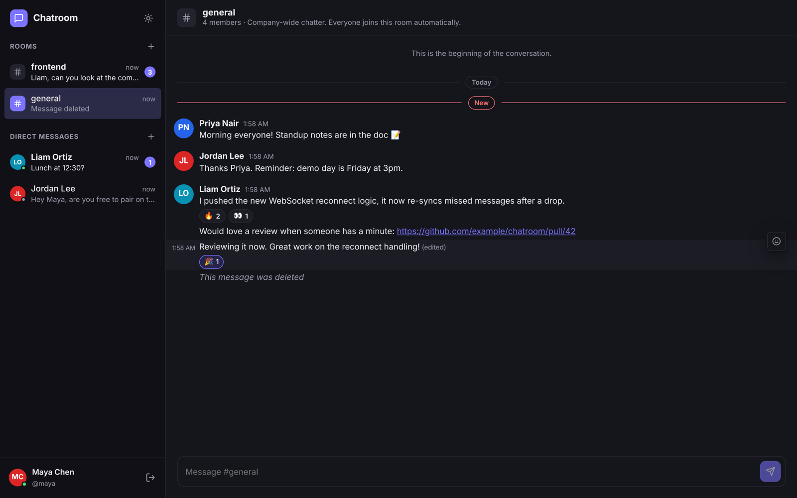
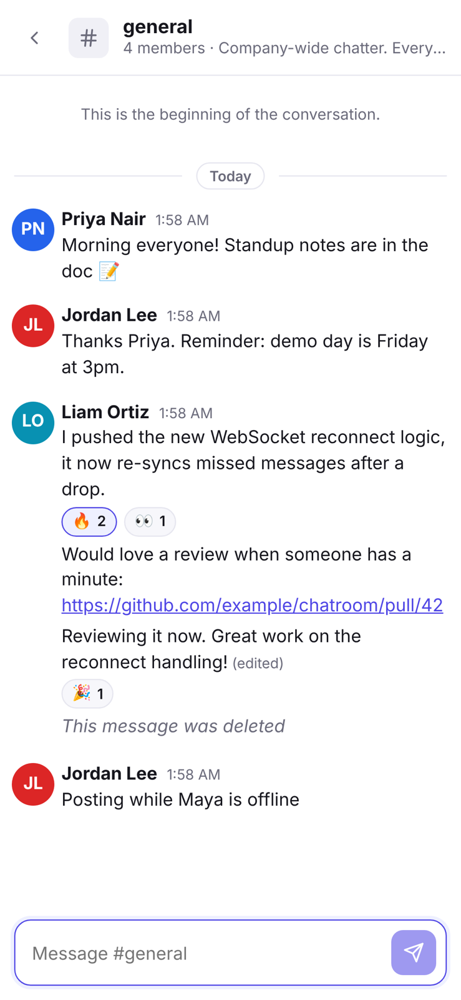
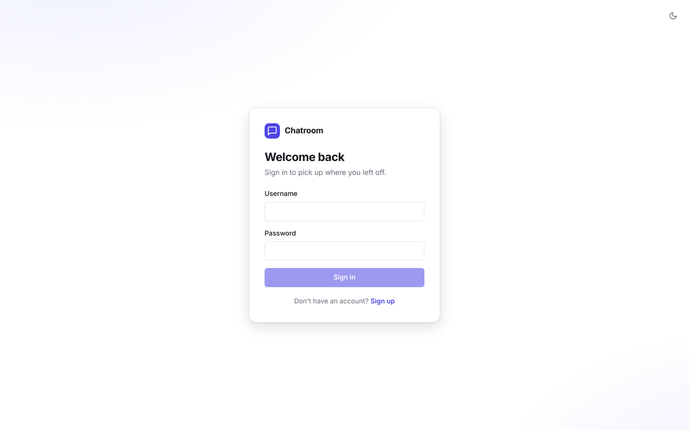
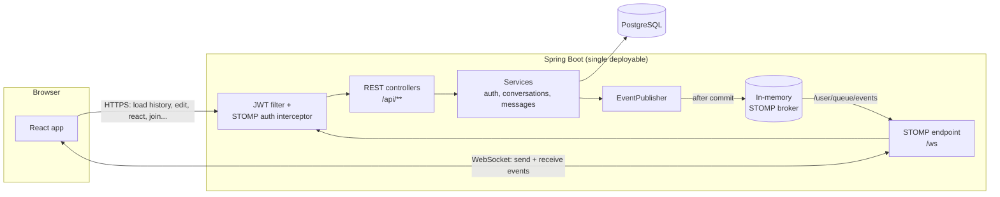
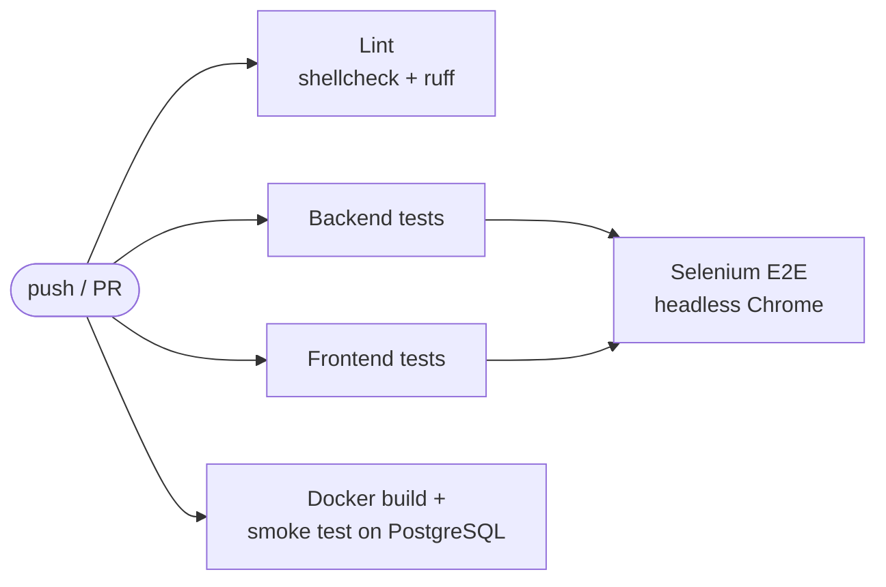

# Chatroom

[](https://github.com/anhad-dhiman/Chatroom/actions/workflows/ci.yml)

A full-stack, real-time chat application with public rooms, private direct messages, reactions, unread tracking and presence, built with **Spring Boot**, **WebSockets (STOMP)**, **PostgreSQL** and **React + TypeScript**.

> **Live demo:** _add your Render URL here after deploying (see [Deployment](#deployment))_



<details>
<summary>More screenshots (dark mode, mobile, sign-in)</summary>



<p align="center"></p>



</details>

---

## Features

**Messaging**
- Real-time delivery over a single WebSocket connection per user (STOMP over native WebSocket)
- Public **rooms**: browse, search, create, join and leave; everyone auto-joins `#general`
- Private 1:1 **direct messages**, created on first use (one conversation per pair, enforced in the database)
- **Edit** and **delete** your own messages (soft delete leaves a "message was deleted" placeholder)
- Emoji **reactions** that toggle on and off, updated live for everyone in the conversation
- Infinite scroll through history using keyset (cursor) pagination
- Clickable links, multi-line messages, grouping of consecutive messages, date separators

**Awareness**
- **Unread counts** per conversation, a "New" divider and an unread total in the browser tab title
- **Online presence** dots, tracked per WebSocket session (multiple tabs are handled correctly)
- Automatic reconnect that re-syncs anything missed while offline

**Experience**
- **Dark mode** (follows the OS setting, with a manual toggle that is remembered)
- Responsive layout that works on phones
- Accessible: keyboard-friendly, labelled controls, ARIA roles, respects reduced-motion

**Engineering**
- Stateless **JWT** auth with BCrypt password hashing; the WebSocket is authenticated on the STOMP `CONNECT` frame
- Authorization on every read and write (non-members get `403`, including over the socket)
- Versioned schema migrations with **Flyway**
- **96 automated tests** across four layers: Java unit and integration tests (including a real WebSocket client), React unit/component tests, and a **Python + Selenium** end-to-end suite that drives real browsers
- **CI pipeline (GitHub Actions)**: lint, all test layers, and a Docker build + smoke test on every push, with per-test reports and failure screenshots
- One **Bash** entry point (`run-tests.sh`) used both locally and in CI
- One-command local run with **Docker Compose**, plus a one-click **Render** blueprint

## Tech stack

| Layer     | Technology |
|-----------|------------|
| Backend   | Java 21, Spring Boot 3.5 (Web, WebSocket/STOMP, Security, Data JPA, Validation, Actuator) |
| Auth      | JWT (jjwt), BCrypt |
| Database  | PostgreSQL 16, Flyway migrations; H2 in-memory for tests and demo mode |
| Frontend  | React 18, TypeScript, Vite, @stomp/stompjs, hand-written CSS with theme variables |
| Testing   | JUnit 5, Spring Boot Test, MockMvc, AssertJ, Vitest, React Testing Library, Python, pytest, Selenium WebDriver |
| CI / tooling | GitHub Actions, Bash, shellcheck, ruff |
| DevOps    | Multi-stage Dockerfile, Docker Compose, Render blueprint |

## Architecture



**How a message flows**
1. The client publishes to `/app/conversations/{id}/send` over its open socket (or `POST`s to the REST endpoint if the socket is down).
2. `MessageService` checks membership, saves the message and moves the sender's read marker forward.
3. `EventPublisher` registers a callback that fires **after the transaction commits**, then sends a `message.created` event to the private queue (`/user/queue/events`) of every member. Clients never see data that was rolled back.
4. Each client's reducer adds the message, ignoring duplicates by id, and updates unread counts and the sidebar preview.

**Key design decisions**
- **Per-user queues instead of per-room topics.** Each client subscribes to exactly one private queue, so there is nothing to authorize per subscription and a client can't listen in on a room it isn't in. The interceptor rejects subscriptions to anything other than `/user/queue/**` and `/topic/presence`.
- **Read markers, not per-message read rows.** Each membership stores `last_read_message_id`, so unread counts for all conversations come from one grouped SQL query.
- **Keyset pagination** (`WHERE id < :before ORDER BY id DESC LIMIT n`) stays fast regardless of history size, unlike `OFFSET`.
- **No N+1 queries.** Senders, reactions, member counts and last messages are batch-loaded when building DTOs.
- **One deployable.** In production, Spring Boot serves the compiled React app, so there is one origin, no CORS and one service to host. In development, Vite proxies `/api` and `/ws` to Spring.
- **Scaling path.** Presence and the STOMP broker are in-memory (one instance). To run several instances, switch to a broker relay (RabbitMQ/ActiveMQ) and keep presence in Redis; the service layer doesn't change.

## Getting started

### Option 1: Docker (recommended)

Requires Docker Desktop.

```bash
docker compose up --build
```

Open <http://localhost:8080>, create an account, then open a second browser (or a private window) with another account to chat between them.

### Option 2: Run locally for development

Requires **Java 21** and **Node 20+**.

**Backend** (pick one):

```bash
cd backend
# a) Zero setup: in-memory H2 database (data resets on restart)
./mvnw spring-boot:run -Dspring-boot.run.profiles=h2

# b) Real PostgreSQL (start one with: docker compose up db)
./mvnw spring-boot:run
```

**Frontend** (in a second terminal):

```bash
cd frontend
npm install
npm run dev
```

Open <http://localhost:5173>. Vite hot-reloads the UI and proxies API/WebSocket calls to the backend on port 8080.

> On Windows, use `mvnw.cmd` instead of `./mvnw`.

### Configuration

All settings have local defaults; override them with environment variables in production.

| Variable | Default | Purpose |
|----------|---------|---------|
| `JWT_SECRET` | dev-only value | HMAC signing key, **at least 32 characters**. Always set this in production. |
| `JWT_EXPIRATION` | `PT168H` (7 days) | Token lifetime (ISO-8601 duration) |
| `DB_HOST` / `DB_PORT` / `DB_NAME` | `localhost` / `5432` / `chatroom` | PostgreSQL location |
| `DB_USER` / `DB_PASSWORD` | `chatroom` / `chatroom` | PostgreSQL credentials |
| `DATABASE_URL` | built from the above | Full JDBC URL; overrides the `DB_*` location variables |
| `PORT` | `8080` | HTTP port (set automatically by most hosts) |
| `CORS_ALLOWED_ORIGINS` | `http://localhost:5173` | Only needed if the frontend is hosted on a different origin |

## Testing & CI

| Layer | Tool | Tests | Where |
|-------|------|------:|-------|
| Backend unit + integration | JUnit 5, Spring Boot Test, MockMvc, STOMP client | 35 | `backend/src/test` |
| Frontend unit + component | Vitest, React Testing Library | 24 | `frontend/src/**/*.test.ts(x)` |
| End-to-end (black-box) | Python, pytest, Selenium WebDriver | 37 | `e2e/` |
| Deployment smoke test | Docker Compose, curl | 3 checks | `.github/workflows/ci.yml` |

Everything runs through one script, locally and in CI:

```bash
./run-tests.sh                 # backend + frontend (fast, ~30 s)
./run-tests.sh --e2e           # build + start the app, run Selenium tests, stop it
./run-tests.sh --e2e --smoke   # only the critical-path browser tests
./run-tests.sh --all           # lint + every test layer
./run-tests.sh --help
```

> On Windows, run it from **Git Bash** (installed with Git for Windows) or WSL. The E2E suite needs Python 3.10+ and Chrome; Selenium downloads the matching driver automatically.

Reports are written to `reports/`: JUnit XML for every layer, plus `reports/e2e/report.html` with a screenshot of the browser for any failing test.

**Highlights**
- Backend integration tests run against an in-memory H2 database in PostgreSQL mode, using the same Flyway migrations as production. `WebSocketIntegrationTest` connects real STOMP clients to check delivery, privacy (outsiders receive nothing) and token rejection.
- The Selenium suite uses the **Page Object Model**, explicit waits (no `sleep`), stable `data-testid` locators, per-test isolated data created through the API, and **two simultaneous browsers** to verify real-time delivery. See [`e2e/README.md`](e2e/README.md).
- The test strategy, scope, entry/exit criteria, defect severity levels and quality metrics are written up in [`docs/TEST_PLAN.md`](docs/TEST_PLAN.md). Bugs are filed with a structured GitHub issue template.

**CI pipeline** ([`.github/workflows/ci.yml`](.github/workflows/ci.yml)) runs on every push and pull request:



Each job publishes per-test results to the GitHub checks tab, and the E2E job uploads its HTML report, screenshots and server log as a downloadable artifact. Combined with branch protection on `main`, a failing job blocks the merge.

## API reference

All endpoints except `/api/auth/*` require `Authorization: Bearer <token>`. Errors return `{"error": "message"}` with an appropriate status code.

| Method | Path | Description |
|--------|------|-------------|
| `POST` | `/api/auth/register` | Create an account → `{ token, user }` |
| `POST` | `/api/auth/login` | Sign in → `{ token, user }` |
| `GET` | `/api/users/me` | Current user |
| `PATCH` | `/api/users/me` | Update display name / avatar color |
| `GET` | `/api/users?query=` | Search users (for starting DMs) |
| `GET` | `/api/users/online` | IDs of users currently online |
| `GET` | `/api/conversations` | My rooms and DMs, with unread counts and last message |
| `GET` | `/api/conversations/{id}` | One conversation (members only) |
| `POST` | `/api/conversations/{id}/read` | Move my read marker: `{ messageId }` |
| `GET` | `/api/conversations/{id}/messages?before=&limit=` | Message history, oldest first (keyset paginated) |
| `POST` | `/api/conversations/{id}/messages` | Send a message: `{ content }` |
| `PATCH` | `/api/messages/{id}` | Edit my message: `{ content }` |
| `DELETE` | `/api/messages/{id}` | Delete my message (soft delete) |
| `POST` | `/api/messages/{id}/reactions` | Toggle a reaction: `{ emoji }` |
| `GET` | `/api/rooms?query=` | Browse/search public rooms |
| `POST` | `/api/rooms` | Create a room: `{ name, description? }` |
| `POST` | `/api/rooms/{id}/join` | Join a room |
| `POST` | `/api/rooms/{id}/leave` | Leave a room |
| `POST` | `/api/direct/{userId}` | Open (or create) the DM with a user |
| `GET` | `/actuator/health` | Health check (public) |

### WebSocket protocol

Connect to `/ws` with STOMP, passing `Authorization: Bearer <token>` as a **CONNECT header**. Browsers can't set headers on the WebSocket handshake itself, so the token goes in the STOMP frame.

| Direction | Destination | Payload |
|-----------|-------------|---------|
| Subscribe | `/user/queue/events` | `{ type, conversationId, payload }`, where `type` is `message.created`, `message.updated`, `member.joined` or `member.left` |
| Subscribe | `/topic/presence` | `{ type: "presence", payload: { userId, online } }` |
| Subscribe | `/user/queue/errors` | Error text for failed socket sends |
| Send | `/app/conversations/{id}/send` | `{ content }` |

## Deployment

The repo includes a [Render](https://render.com) blueprint (`render.yaml`) that provisions a free PostgreSQL database and a Docker web service, wires the database credentials in and generates a random `JWT_SECRET`.

1. Push this repository to GitHub.
2. In Render, choose **New → Blueprint** and select the repository.
3. Click **Apply**. The first build takes a few minutes.
4. Open the `chatroom` service URL and put it at the top of this README as the live demo.

> Free Render web services sleep when idle, so the first request after a while can take about a minute. Free Render databases expire after a limited period; check Render's current free-tier terms.

The same Docker image runs on any container host (Railway, Fly.io, AWS App Runner, a VPS). Provide the `DB_*` and `JWT_SECRET` environment variables.

## Project structure

```
.
├── backend/                      Spring Boot application
│   ├── src/main/java/com/anhad/chatroom/
│   │   ├── auth/                 register / login
│   │   ├── config/               security, WebSocket broker
│   │   ├── conversation/         rooms, DMs, membership, unread counts
│   │   ├── message/              messages, edits, reactions (REST + STOMP controllers)
│   │   ├── realtime/             event fan-out, presence tracking
│   │   ├── security/             JWT service, HTTP filter, STOMP interceptor
│   │   ├── user/                 profiles, search
│   │   └── common/               error handling
│   ├── src/main/resources/db/migration/   Flyway SQL migrations
│   └── src/test/                 integration + unit tests
├── frontend/                     React + TypeScript (Vite)
│   └── src/
│       ├── api/                  typed REST client and DTO types
│       ├── auth/                 auth context (token storage, session restore)
│       ├── realtime/             STOMP connection hook with auto-reconnect
│       ├── state/                chat reducer (pure, unit-tested)
│       ├── components/           UI components
│       └── lib/                  formatting helpers
├── e2e/                          Python + Selenium end-to-end suite (see e2e/README.md)
│   ├── framework/                config, WebDriver factory, REST client for test data
│   ├── pages/                    Page Objects
│   └── tests/                    auth, access control, search, messaging, real-time
├── .github/
│   ├── workflows/ci.yml          CI pipeline
│   └── ISSUE_TEMPLATE/           structured bug report form
├── docs/                         screenshots, TEST_PLAN.md
├── run-tests.sh                  single entry point for every test layer (local + CI)
├── Dockerfile                    multi-stage build: frontend → backend → slim JRE image
├── docker-compose.yml            app + PostgreSQL
└── render.yaml                   one-click cloud deployment
```

## Possible next steps

- Typing indicators and read receipts ("seen by")
- File and image uploads (S3-compatible storage)
- Message search (PostgreSQL full-text search)
- Private, invite-only rooms with roles (owner/moderator)
- Horizontal scaling with a RabbitMQ STOMP relay and Redis-backed presence
- Refresh tokens in HttpOnly cookies instead of a token in `localStorage`

## Background

This started as a terminal chat server built on raw Java sockets and a thread pool. Version 2 is a ground-up rewrite into a production-style web application. It keeps the original core idea (a concurrent server broadcasting to connected clients) and adds persistence, authentication, authorization, a real-time protocol, a web UI, tests and deployment.
